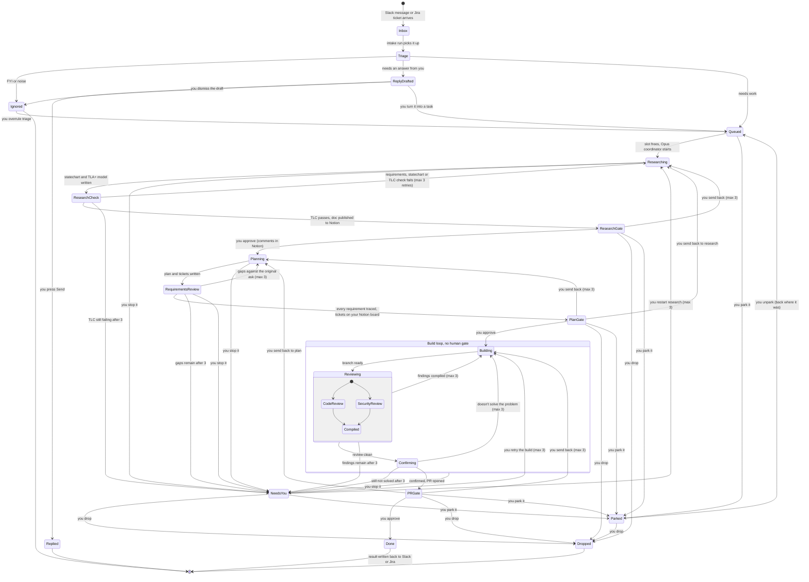

# One task's life

The engine enforces this chart: `src/workflow/statechart.ts` is the code copy of [`Factory.tla`](Factory.tla), and
CI model-checks the spec with TLC at `Cap = 3` on every PR (`npm run tlc` does the same locally).

| Rule | Invariant |
| --- | --- |
| Research rule | No task reaches the research gate, planning, building or done without a statechart and a passing TLC check |
| Coverage rule | You only see a plan once an independent review has traced every requirement in the original Slack message or Jira ticket into it |
| Build rule | Building only starts on approved research and an approved plan |
| PR rule | You only see code once review is clean and the change is confirmed to solve the problem |
| Gates rule | Done only after research, plan and PR are all approved |
| Caps | At most 3 send-backs per gate, and 3 rounds per automatic loop (research check, requirements review, review findings, confirm); then Needs you, also capped at 3 |
| Ends or parked | Every task ends as Ignored, Replied, Done or Dropped, or waits in Parked because you put it there |

Beyond the original design, the model adds three moves that only a person makes, so fairness never
forces them: dismissing a drafted reply, overruling triage (an ignored item or a draft becomes a task),
and stopping a running stage (it goes to Needs you, whose cap still applies). TLC checks every rule with
them in: 15,689,700 distinct states, no errors.

